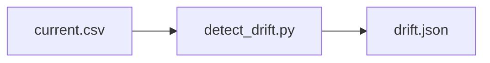

# Architecture — Schema Drift Detector

## Inputs

- `sample/current.csv`
- `sample/baseline.csv`

## Source files

- `src/detect_drift.py`

## Output

- `results/artifacts/drift.json`

This representation is intended for source navigation. It does not imply a production deployment or undisclosed components. The editable diagram is available as [`architecture.mmd`](architecture.mmd).
